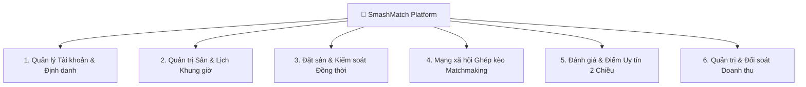
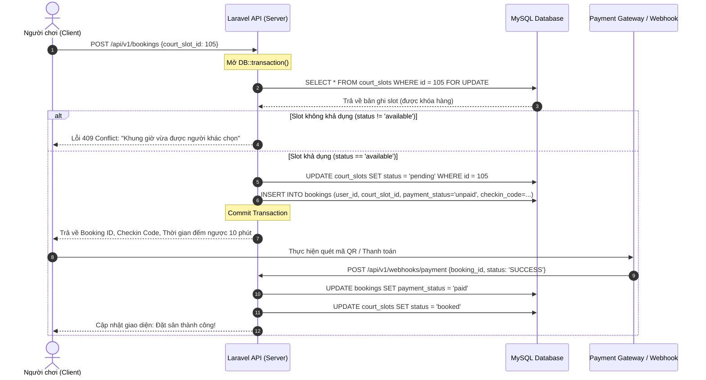
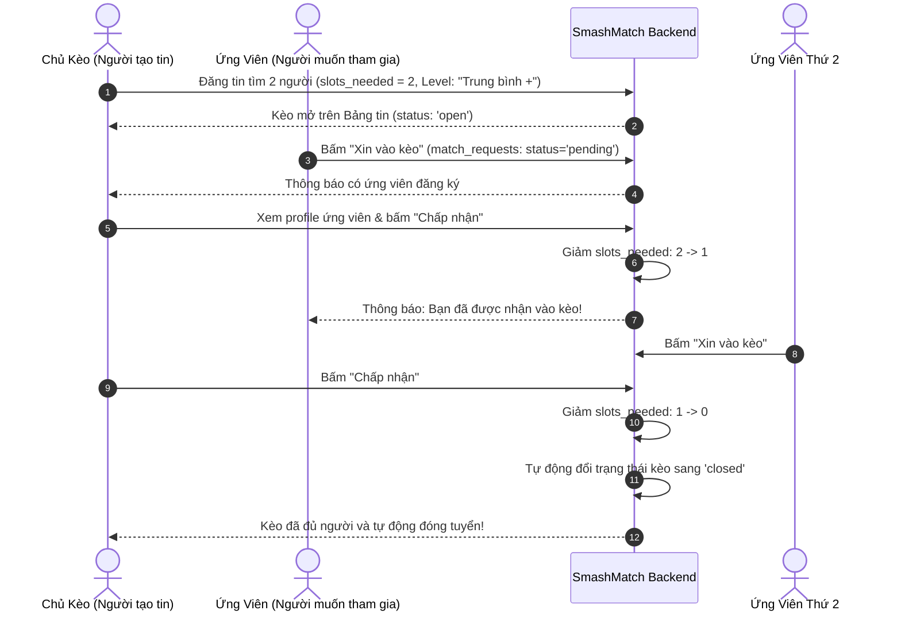

# 🏸 SMASHMATCH — TÀI LIỆU ĐẶC TẢ NGHIỆP VỤ HỆ THỐNG (BRD & SRS)
**Hệ Thống Đặt Sân Cầu Lông Trực Tuyến & Mạng Xã Hội Ghép Kèo Thể Thao Thông Minh**
*Phiên bản:* 1.0.0 | *Dự án:* Đồ án Tốt nghiệp / K22 AIBP | *Ngày cập nhật:* 2026-10-16

---

## 1. GIỚI THIỆU TỔNG QUAN DỰ ÁN

### 1.1. Bối cảnh & Vấn đề thực tế
Tại các đô thị hiện nay, phong trào tập luyện và thi đấu cầu lông phát triển bùng nổ nhưng vận hành đặt sân và giao lưu vẫn tồn tại các điểm nghẽn nghiêm trọng:
1. **Khó khăn trong đặt sân và giữ chỗ:** Người chơi thường phải gọi điện thoại, nhắn tin Zalo hoặc đến trực tiếp để hỏi lịch trống; chủ sân quản lý bằng sổ tay hoặc file Excel rời rạc dẫn đến tình trạng **Double-booking (trùng lịch)**, nhầm lẫn khung giờ cao điểm (Peak-hours).
2. **"Thiếu tay" - Khó tìm bạn chơi cùng trình độ:** Rất nhiều người chơi hoặc nhóm bạn có sân nhưng thiếu người (thiếu 1-2 người đánh đôi), hoặc người chơi đơn lẻ (solo player) không tìm được nhóm có cùng trình độ (Yếu / Trung bình / Khá / Chuyên) và cùng khu vực địa lý.
3. **Thiếu cơ chế thanh toán & check-in minh bạch:** Tình trạng hủy sân sát giờ (No-show), quỵt tiền cọc hoặc tranh chấp về chi phí chia sẻ khi ghép kèo diễn ra thường xuyên mà không có cơ chế giữ tiền hoặc đánh giá uy tín (Rating/Karma system).

### 1.2. Mục tiêu hệ thống SmashMatch
SmashMatch được xây dựng như một nền tảng Web Application hiện đại kết hợp hai giải pháp mũi nhọn:
* **Hệ thống đặt sân tức thì (Real-time Court Booking Engine):** Quản lý trạng thái từng khung giờ (Slot), kiểm soát đồng thời (Concurrency Control) chống đặt trùng, tích hợp giữ chỗ tạm thời (10-minute Lock) và thanh toán tự động qua QR Webhook.
* **Sàn ghép kèo thông minh (Matchmaking & Social Board):** Môi trường kết nối người chơi theo cấp bậc kỹ năng (Skill Level), quản lý slot tuyển quân, phê duyệt người tham gia và tự động đóng kèo khi đủ quân số.

---

## 2. CÁC TÁC NHÂN HỆ THỐNG (ACTORS & PERSONAS)

| STT | Tác nhân (Actor) | Vai trò & Mục tiêu chính |
| :--- | :--- | :--- |
| **1** | **Guest / Khách vãng lai** | Xem danh sách sân, bảng giá khung giờ, xem các bài đăng ghép kèo công khai, đăng ký/đăng nhập tài khoản. |
| **2** | **Player (Vận động viên / Người chơi)** | Tìm kiếm sân, đặt slot thi đấu, thanh toán cọc, nhận mã Check-in QR, tạo bài đăng ghép kèo, xin gia nhập kèo người khác, đánh giá sân và bạn chơi. |
| **3** | **Court Owner (Chủ cụm sân)** | Khởi tạo và quản trị sân thi đấu, cấu hình khung giờ và giá vé (ngày thường/cuối tuần), quét mã QR đối soát check-in của khách, theo dõi doanh thu và công suất sân. |
| **4** | **System Admin (Quản trị viên toàn hệ thống)** | Kiểm duyệt và kích hoạt chủ sân, quản lý tài khoản người dùng, giám sát báo cáo tài chính toàn sàn, xử lý khiếu nại và khóa tài khoản gian lận. |

---

## 3. DANH MỤC PHÂN HỆ NGHIỆP VỤ (MODULE BREAKDOWN)

### 3.1. Phân hệ 1: Quản lý Tài khoản & Định danh (Authentication & Profile)
* **UC-01 Đăng ký tài khoản (Register):** Người dùng đăng ký bằng Họ tên, Email, Mật khẩu. Mặc định tài khoản có role `player`, `rating_score` khởi tạo là `5.0/5.0`, `matches_played = 0`.
* **UC-02 Đăng nhập (Login):** Xác thực mật khẩu mã hóa Bcrypt/Argon2, cấp phát Token định danh Bearer (Laravel Sanctum).
* **UC-03 Hồ sơ người chơi (User Profile):** Hiển thị điểm số uy tín, số trận đã tham gia, lịch sử các bài đăng và huy hiệu kỹ năng.

### 3.2. Phân hệ 2: Quản lý Sân & Lịch Khung Giờ (Court & Slot Engine)
* **UC-04 Quản lý thông tin sân (Court Info):** Tên sân, địa chỉ chi tiết (Quận/Huyện/Thành phố), mô tả tiện ích (thảm PVC chuẩn BWF, đèn chống lóa, điều hòa, quầy nước, thuê vợt), trạng thái hoạt động `is_active`.
* **UC-05 Thiết lập ca/khung giờ (Court Slots):**
  * Mỗi slot xác định bởi: `court_id`, `play_date`, `start_time`, `end_time`, `price`, `status`.
  * Trạng thái slot gồm 3 giá trị nghiêm ngặt:
    * `available`: Khung giờ còn trống, sẵn sàng cho đặt.
    * `pending`: Khung giờ đang có người chọn và đang chờ thanh toán (thời hạn 10 phút).
    * `booked`: Khung giờ đã thanh toán thành công, khóa vĩnh viễn.

### 3.3. Phân hệ 3: Đặt sân Trực tuyến & Thanh toán (Booking & Concurrency Engine)
* **UC-06 Đặt giữ chỗ (Reserve Slot):**
  * Người dùng chọn 1 khung giờ `available`.
  * Hệ thống mở Transaction với cơ chế Row-level Lock (`lockForUpdate()`) để xác minh lại trạng thái slot.
  * Nếu thành công: Slot chuyển sang `pending`, tạo bản ghi `bookings` với `payment_status = 'unpaid'`, sinh chuỗi `checkin_code` duy nhất 8 ký tự kèm mã QR. Khởi chạy đồng hồ đếm ngược 10 phút.
  * Nếu slot vừa bị người khác chọn: Trả về lỗi `409 Conflict`, thông báo cho người dùng chọn slot khác.
* **UC-07 Thanh toán & Webhook (Payment Execution):**
  * Hỗ trợ thanh toán qua Cổng thanh toán / QR Code tự động (MoMo / VNPAY / Giả lập Webhook).
  * Webhook nhận kết quả thành công -> Cập nhật booking sang `paid`, chuyển slot sang `booked`.
* **UC-08 Hủy slot quá hạn (Auto-release Expired Slots):**
  * Sau 10 phút nếu booking vẫn là `unpaid`, tiến trình ngầm (Cron job / Scheduled task) tự động hủy booking và hoàn trả trạng thái slot từ `pending` về lại `available`.

### 3.4. Phân hệ 4: Ghép Kèo Cầu Lông (Matchmaking Board)
* **UC-09 Đăng tin tìm bạn chơi (Create Match Post):**
  * Chủ kèo (người tạo tin) có thể gắn kèm mã `booking_id` (nếu đã đặt sân trước) hoặc tạo kèo mở thỏa thuận sau.
  * Thiết lập tiêu chí:
    * `level_required`: Cấp độ yêu cầu (`Yếu`, `Trung bình -`, `Trung bình +`, `Khá`, `Bán chuyên`).
    * `slots_needed`: Số lượng người chơi cần tuyển thêm (ví dụ: cần 1 hoặc 2 người).
    * `estimated_cost_per_person`: Chi phí ước tính chia đều trên mỗi người chơi (VNĐ).
    * `note`: Ghi chú chi tiết (ví dụ: *"Có sẵn cầu Thành Công, có vợt Kumpoo K520 Pro và VS Titan 7 cho mượn, giao lưu vui vẻ"*).
* **UC-10 Xin gia nhập kèo (Join Request):**
  * Người chơi xem bảng tin, bấm "Gửi yêu cầu tham gia". Bản ghi `match_requests` được tạo với trạng thái `pending`.
* **UC-11 Phê duyệt thành viên (Accept / Reject Request):**
  * Chủ kèo xem danh sách ứng viên, thông tin điểm uy tín (`rating_score`) và số trận đã đánh của ứng viên.
  * Chủ kèo bấm `Chấp nhận (Accept)`:
    * Trạng thái request chuyển sang `accepted`.
    * Hệ thống tự động trừ 1 vào `slots_needed` của bài đăng.
    * **Nếu `slots_needed == 0`**: Hệ thống tự động chuyển trạng thái bài đăng sang `closed` (Đã đủ người).
  * Nếu bấm `Từ chối (Reject)`: Trạng thái chuyển sang `rejected`, bài đăng vẫn giữ nguyên số slot còn trống.

### 3.5. Phân hệ 5: Đánh giá & Xếp hạng Uy tín Hai Chiều (Review & Rating)
* **UC-12 Đánh giá chất lượng sân:** Khách sau khi hoàn thành buổi đánh được chấm điểm từ 1 - 5 sao và viết nhận xét về mặt sân, ánh sáng, thái độ phục vụ.
* **UC-13 Đánh giá bạn chơi (Peer Review):** Các thành viên trong cùng một kèo ghép có quyền đánh giá lẫn nhau sau trận đấu:
  * Điểm số tính vào `rating_score` trung bình của người dùng.
  * Giúp cộng đồng tự thanh lọc những người chơi thiếu văn minh, bùng kèo (No-show), hoặc khai gian trình độ.

### 3.6. Phân hệ 6: Quản trị Dành cho Chủ Sân & Admin (Owner & Admin Operations)
* **UC-14 Quét mã Check-in tại sân:** Chủ sân mở camera quét mã QR hoặc nhập `checkin_code` của người chơi để xác nhận vào sân, ngăn chặn gian lận vé.
* **UC-15 Quản lý bảng giá & sinh lịch tự động:** Chủ sân có công cụ sinh hàng loạt slot theo ngày/tuần với các mức giá khác nhau cho giờ thường và giờ vàng (17:00 - 21:00).
* **UC-16 Báo cáo doanh thu & tỷ lệ lấp đầy:** Biểu đồ hiển thị doanh thu theo tuần/tháng, số giờ được thuê trên tổng công suất sân (Occupancy Rate).

---

## 4. QUY TẮC NGHIỆP VỤ BẮT BUỘC (BUSINESS RULES - BR)

| Mã BR | Tên quy tắc nghiệp vụ | Mô tả chi tiết & Hành vi hệ thống |
| :--- | :--- | :--- |
| **BR-01** | **Chống Double-Booking Tuyệt Đối** | Không bao giờ cho phép 2 giao dịch cùng đặt thành công một `court_slot_id`. Bắt buộc dùng `lockForUpdate()` trong Transaction. |
| **BR-02** | **Thời Gian Giữ Chỗ Tạm Thời** | Slot ở trạng thái `pending` tối đa **10 phút**. Quá thời gian này, hệ thống coi như giao dịch thất bại và trả slot về `available`. |
| **BR-03** | **Tính Hợp Lệ Của Khung Giờ** | Khung giờ đặt phải nằm trong tương lai (tính từ thời điểm hiện tại). Không cho phép đặt slot của ngày hoặc giờ đã trôi qua. |
| **BR-04** | **Quyền Chủ Sân (Court Ownership)** | Một User chỉ được phép chỉnh sửa, tạo slot hoặc xem doanh thu của các sân mà mình sở hữu (`owner_id == user.id`). |
| **BR-05** | **Tự Động Đóng Kèo Ghép** | Khi số người được chấp nhận (`accepted`) bằng đúng số lượng tuyển ban đầu (`slots_needed == 0`), bài đăng lập tức chuyển sang trạng thái `closed`. |
| **BR-06** | **Chống Trùng Yêu Cầu Ghép Kèo** | Một người chơi không được gửi 2 yêu cầu tham gia cùng lúc vào một bài đăng khi yêu cầu trước đó vẫn đang ở trạng thái `pending`. |
| **BR-07** | **Mã Check-in Độc Bản** | Mỗi đơn đặt sân thành công được cấp một `checkin_code` duy nhất gồm 8 ký tự ngẫu nhiên (chữ in hoa và số) mã hóa thành mã QR bảo mật. |
| **BR-08** | **Cơ Chế Tính Điểm Uy Tín** | Điểm uy tín người chơi là trung bình cộng số sao từ các đánh giá nhận được (`reviewsReceived`). Làm tròn đến 1 chữ số thập phân (VD: 4.8 / 5.0). |

---

## 5. SƠ ĐỒ LUỒNG NGHIỆP VỤ CỐT LÕI (CORE WORKFLOWS)

### 5.1. Luồng Nghiệp Vụ Đặt Sân Chống Trùng (Concurrency Booking Flow)

### 5.2. Luồng Nghiệp Vụ Ghép Kèo & Tự Động Đóng Kèo (Matchmaking Workflow)

---

## 6. MA TRẬN PHÂN QUYỀN HỆ THỐNG (ROLE & PERMISSION MATRIX)

| Hành động nghiệp vụ | Khách (Guest) | Người chơi (Player) | Chủ sân (Owner) | Quản trị (Admin) |
| :--- | :---: | :---: | :---: | :---: |
| Xem danh sách sân & lịch slot trống | ✅ | ✅ | ✅ | ✅ |
| Xem bảng tin ghép kèo | ✅ | ✅ | ✅ | ✅ |
| Đặt sân & Giữ chỗ 10 phút | ❌ | ✅ | ✅ | ✅ |
| Hủy đơn đặt sân cá nhân | ❌ | ✅ | ❌ | ✅ |
| Tạo bài đăng ghép kèo | ❌ | ✅ | ✅ | ✅ |
| Gửi yêu cầu xin vào kèo | ❌ | ✅ | ❌ | ❌ |
| Duyệt / từ chối người vào kèo của mình | ❌ | ✅ (chủ bài) | ✅ (chủ bài) | ✅ |
| Thêm mới sân & chỉnh sửa thông tin sân | ❌ | ❌ | ✅ (sân của mình) | ✅ (tất cả) |
| Khởi tạo / xóa khung giờ (court slots) | ❌ | ❌ | ✅ (sân của mình) | ✅ (tất cả) |
| Quét mã Check-in khách vào sân | ❌ | ❌ | ✅ (sân của mình) | ✅ (tất cả) |
| Xem báo cáo doanh thu cụm sân | ❌ | ❌ | ✅ (sân của mình) | ✅ (toàn sàn) |
| Khóa tài khoản / Kiểm duyệt nội dung | ❌ | ❌ | ❌ | ✅ |
