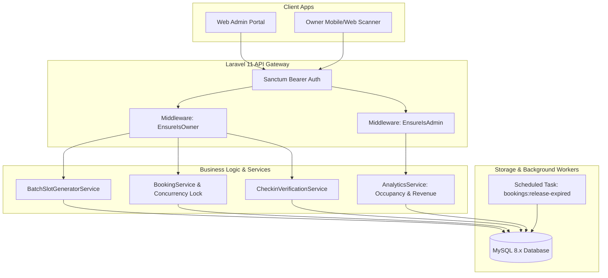

# 🛡️ SMASHMATCH — TÀI LIỆU KỸ THUẬT PHÍA ADMIN & CHỦ SÂN (BACKEND ARCHITECTURE & AI IMPLEMENTATION)
**Hệ Thống Đặt Sân Cầu Lông Trực Tuyến & Ghép Kèo Thể Thao Thông Minh**
*Phiên bản:* 1.0.0 | *Công nghệ:* Laravel 11.x + MySQL 8.x + Laravel Sanctum | *Ngày cập nhật:* 2026-10-16

---

## 1. TỔNG QUAN KIẾN TRÚC PHÂN HỆ QUẢN TRỊ (ADMIN & OWNER ARCHITECTURE)

Phân hệ Quản trị của SmashMatch được thiết kế theo mô hình **RESTful API phân tầng chặt chẽ (Controller - FormRequest - Service - Model - Resource)** trên nền tảng **Laravel 11.x**. Hệ thống phân định rõ ràng giữa hai cấp độ quản trị:
* **System Admin (Quản trị viên toàn sàn):** Giám sát tài khoản, duyệt chủ sân, xử lý gian lận, xem báo cáo vĩ mô toàn hệ thống.
* **Court Owner (Chủ cụm sân):** Quản lý thông tin sân bãi, công cụ sinh khung giờ tự động (Batch Slot Generator), thiết lập giá giờ vàng, quét mã QR Check-in đón khách và đối soát doanh thu thực thu.



---

## 2. PHÂN QUYỀN TRUY CẬP DỰA TRÊN VAI TRÒ (RBAC & POLICIES)

### 2.1. Middleware Phân Quyền
Hệ thống sử dụng hai Middleware cốt lõi trong `app/Http/Middleware/`:
* `EnsureUserIsAdmin.php`: Chặn truy cập nếu `$request->user()->role !== 'admin'`.
* `EnsureUserIsOwner.php`: Chặn truy cập nếu `$request->user()->role !== 'owner' && $request->user()->role !== 'admin'`.

### 2.2. Policy & Quyền Sở Hữu (Ownership Validation)
Khi chủ sân thao tác lên một sân cầu lông cụ thể (`Court`) hoặc một khung giờ (`CourtSlot`), hệ thống bắt buộc kiểm tra qua `CourtPolicy`:
```php
namespace App\Policies;

use App\Models\Court;
use App\Models\User;

class CourtPolicy
{
    /**
     * Admin có toàn quyền, Owner chỉ được sửa sân mình sở hữu.
     */
    public function update(User $user, Court $court): bool
    {
        return $user->isAdmin() || $court->owner_id === $user->id;
    }

    public function delete(User $user, Court $court): bool
    {
        return $user->isAdmin() || $court->owner_id === $user->id;
    }
}
```

---

## 3. CƠ CHẾ CHỐNG DOUBLE-BOOKING & KHÓA DỮ LIỆU ĐỒNG THỜI (CONCURRENCY ENGINE)

### 3.1. Nguyên Lý Khóa Hàng Bi Quan (Pessimistic Locking)
Để giải quyết triệt để bài toán **Race Condition (Tranh chấp đặt sân)** khi hàng chục người cùng bấm đặt 1 khung giờ duy nhất vào lúc 17:00, phương thức `POST /api/v1/bookings` được triển khai với giao dịch cơ sở dữ liệu nghiêm ngặt:

```php
namespace App\Http\Controllers\Api\V1;

use App\Http\Controllers\Controller;
use App\Http\Requests\StoreBookingRequest;
use App\Http\Resources\BookingResource;
use App\Models\CourtSlot;
use App\Models\Booking;
use Illuminate\Support\Facades\DB;
use Illuminate\Support\Str;
use Symfony\Component\HttpFoundation\Response;

class BookingController extends Controller
{
    public function store(StoreBookingRequest $request)
    {
        $userId = $request->user()->id;
        $slotId = $request->validated('court_slot_id');

        return DB::transaction(function () use ($userId, $slotId) {
            // 🔒 1. Khóa hàng bi quan trên bảng court_slots
            $slot = CourtSlot::where('id', $slotId)
                ->lockForUpdate()
                ->firstOrFail();

            // ⚠️ 2. Kiểm tra tính khả dụng
            if ($slot->status !== 'available') {
                return response()->json([
                    'status'  => false,
                    'message' => 'Khung giờ này vừa được người khác chọn. Vui lòng chọn khung giờ khác!',
                ], Response::HTTP_CONFLICT); // 409 Conflict
            }

            // ⏱️ 3. Chuyển slot sang trạng thái PENDING (giữ chỗ tạm 10 phút)
            $slot->update(['status' => 'pending']);

            // 🎟️ 4. Khởi tạo mã check-in độc bản 8 ký tự
            $checkinCode = strtoupper(Str::random(8));

            // 📝 5. Tạo đơn đặt sân ở trạng thái UNPAID
            $booking = Booking::create([
                'user_id'        => $userId,
                'court_slot_id'  => $slot->id,
                'total_price'    => $slot->price,
                'payment_status' => 'unpaid',
                'checkin_code'   => $checkinCode,
            ]);

            return (new BookingResource($booking))
                ->additional([
                    'status'  => true,
                    'message' => 'Giữ chỗ thành công! Vui lòng thanh toán trong vòng 10 phút.',
                    'expires_in_seconds' => 600,
                ])
                ->response()
                ->setStatusCode(Response::HTTP_CREATED);
        });
    }
}
```

### 3.2. Tiến Trình Ngầm Giải Phóng Slot Quá Hạn (Auto-release Worker)
Để tránh việc người chơi vào giữ chỗ nhưng không thanh toán làm "chết" sân, hệ thống kích hoạt Scheduled Command:

* **Tên Command:** `php artisan bookings:release-expired`
* **File:** `app/Console/Commands/ReleaseExpiredBookings.php`
* **Chu kỳ thực thi:** Chạy ngầm định kỳ mỗi phút (`$schedule->command('bookings:release-expired')->everyMinute();`).
* **Thuật toán xử lý:**
```php
namespace App\Console\Commands;

use Illuminate\Console\Command;
use App\Models\Booking;
use App\Models\CourtSlot;
use Illuminate\Support\Facades\DB;
use Carbon\Carbon;

class ReleaseExpiredBookings extends Command
{
    protected $signature = 'bookings:release-expired';
    protected $description = 'Giải phóng các khung giờ pending quá hạn 10 phút chưa thanh toán';

    public function handle()
    {
        $expirationTime = Carbon::now()->subMinutes(10);

        $expiredBookings = Booking::where('payment_status', 'unpaid')
            ->where('created_at', '<=', $expirationTime)
            ->get();

        foreach ($expiredBookings as $booking) {
            DB::transaction(function () use ($booking) {
                // Đổi trạng thái booking thành đã hủy do hết hạn
                $booking->update(['payment_status' => 'refunded']);

                // Hoàn trả slot về available
                CourtSlot::where('id', $booking->court_slot_id)
                    ->where('status', 'pending')
                    ->update(['status' => 'available']);
            });
            $this->info("Đã hoàn trả slot #{$booking->court_slot_id} từ booking #{$booking->id}");
        }

        return self::SUCCESS;
    }
}
```

---

## 4. BỘ CÔNG CỤ SINH LỊCH KHUNG GIỜ HÀNG LOẠT (BATCH SLOT GENERATOR SERVICE)

Một vấn đề lớn của chủ sân cầu lông là phải tạo thủ công hàng trăm khung giờ mỗi tuần. SmashMatch cung cấp `BatchSlotGeneratorService` cho phép sinh lịch tự động trong 1 giây:

### 4.1. Thông số đầu vào (Input Parameters)
* `court_id`: ID sân cầu lông.
* `start_date` & `end_date`: Khoảng ngày áp dụng (VD: từ `2026-10-20` đến `2026-10-26`).
* `open_time` & `close_time`: Giờ mở cửa & đóng cửa (VD: `06:00:00` đến `22:00:00`).
* `slot_duration_minutes`: Thời lượng mỗi slot (mặc định `60` phút).
* `regular_price`: Giá giờ tiêu chuẩn (VD: `60.000 VNĐ`).
* `peak_hours`: Danh sách giờ vàng kèm giá đặc biệt (VD: từ `17:00` đến `21:00` có giá `90.000 VNĐ`).

### 4.2. Mã nguồn triển khai Service Layer
```php
namespace App\Services;

use App\Models\CourtSlot;
use Carbon\Carbon;
use Carbon\CarbonPeriod;

class BatchSlotGeneratorService
{
    public function generate(array $params): int
    {
        $courtId   = $params['court_id'];
        $period    = CarbonPeriod::create($params['start_date'], $params['end_date']);
        $openTime  = Carbon::createFromTimeString($params['open_time']);
        $closeTime = Carbon::createFromTimeString($params['close_time']);
        $duration  = $params['slot_duration_minutes'] ?? 60;
        $normalPrice = $params['regular_price'];
        $peakPrice   = $params['peak_price'] ?? $normalPrice;
        $peakStartHour = $params['peak_start_hour'] ?? 17;
        $peakEndHour   = $params['peak_end_hour'] ?? 21;

        $slotsToInsert = [];
        $now = Carbon::now();

        foreach ($period as $date) {
            $currentSlotStart = $date->copy()->setTime($openTime->hour, $openTime->minute, 0);
            $dayCloseTime     = $date->copy()->setTime($closeTime->hour, $closeTime->minute, 0);

            while ($currentSlotStart->copy()->addMinutes($duration)->lte($dayCloseTime)) {
                $currentSlotEnd = $currentSlotStart->copy()->addMinutes($duration);

                // Xác định giá giờ thường hay giờ cao điểm (Peak-hour)
                $isPeak = ($currentSlotStart->hour >= $peakStartHour && $currentSlotStart->hour < $peakEndHour);
                $price  = $isPeak ? $peakPrice : $normalPrice;

                $slotsToInsert[] = [
                    'court_id'   => $courtId,
                    'play_date'  => $date->toDateString(),
                    'start_time' => $currentSlotStart->toTimeString(),
                    'end_time'   => $currentSlotEnd->toTimeString(),
                    'price'      => $price,
                    'status'     => 'available',
                    'created_at' => $now,
                    'updated_at' => $now,
                ];

                $currentSlotStart->addMinutes($duration);
            }
        }

        // Chèn hàng loạt với chunk 100 bản ghi để tối ưu I/O database
        foreach (array_chunk($slotsToInsert, 100) as $chunk) {
            CourtSlot::insertOrIgnore($chunk);
        }

        return count($slotsToInsert);
    }
}
```

---

## 5. CƠ CHẾ ĐỐI SOÁT VÀ QUÉT MÃ QR CHECK-IN TẠI QUẦY (CHECK-IN VERIFICATION)

### 5.1. Quy trình Check-in
Khi người chơi đến sân, chủ sân hoặc nhân viên quầy mở màn hình Scanner, nhập hoặc quét mã QR chứa `checkin_code`.

### 5.2. Endpoint Xác Thực Check-in
* **Route:** `POST /api/v1/owner/checkin/verify`
* **Request Body:** `{ "checkin_code": "SM88291A" }`
* **Controller Implementation:**
```php
public function verifyCheckin(Request $request)
{
    $request->validate(['checkin_code' => 'required|string|size:8']);

    $booking = Booking::with(['user', 'courtSlot.court'])
        ->where('checkin_code', $request->input('checkin_code'))
        ->first();

    if (!$booking) {
        return response()->json([
            'status'  => false,
            'message' => 'Mã vé không tồn tại trong hệ thống!',
        ], 404);
    }

    // Kiểm tra tính hợp lệ của sân: Owner chỉ được soát vé sân của mình
    if (!$request->user()->isAdmin() && $booking->courtSlot->court->owner_id !== $request->user()->id) {
        return response()->json([
            'status'  => false,
            'message' => 'Vé này thuộc cụm sân khác, không hợp lệ tại sân của bạn!',
        ], 403);
    }

    if ($booking->payment_status !== 'paid') {
        return response()->json([
            'status'  => false,
            'message' => 'Đơn đặt sân này chưa được thanh toán!',
        ], 400);
    }

    return response()->json([
        'status'  => true,
        'message' => 'Xác thực thành công! Khách hàng hợp lệ.',
        'data'    => [
            'booking_id'    => $booking->id,
            'customer_name' => $booking->user->name,
            'court_name'    => $booking->courtSlot->court->name,
            'play_date'     => $booking->courtSlot->play_date,
            'time_slot'     => "{$booking->courtSlot->start_time} - {$booking->courtSlot->end_time}",
            'total_price'   => $booking->total_price,
        ]
    ]);
}
```

---

## 6. DANH MỤC API DÀNH CHO ADMIN & CHỦ SÂN (ADMIN & OWNER API CONTRACTS)

| Phương thức | Đường dẫn API | Phân quyền | Mô tả chi tiết |
| :--- | :--- | :---: | :--- |
| `POST` | `/api/v1/owner/courts` | `owner, admin` | Tạo mới một cụm sân cầu lông |
| `PUT` | `/api/v1/owner/courts/{id}` | `owner, admin` | Cập nhật thông tin, tiện ích sân |
| `DELETE` | `/api/v1/owner/courts/{id}` | `owner, admin` | Ngừng kích hoạt cụm sân |
| `POST` | `/api/v1/owner/courts/{id}/slots/batch` | `owner, admin` | Gọi `BatchSlotGeneratorService` sinh lịch |
| `DELETE` | `/api/v1/owner/slots/{slot_id}` | `owner, admin` | Hủy khung giờ (chỉ xóa được khi `available`) |
| `POST` | `/api/v1/owner/checkin/verify` | `owner, admin` | Quét mã Check-in 8 ký tự của khách |
| `GET` | `/api/v1/owner/reports/revenue` | `owner, admin` | Báo cáo doanh thu theo tuần, tháng |
| `GET` | `/api/v1/owner/reports/occupancy` | `owner, admin` | Báo cáo công suất lấp đầy sân (%) |
| `GET` | `/api/v1/admin/users` | `admin` | Xem danh sách toàn bộ người dùng và chủ sân |
| `PATCH` | `/api/v1/admin/users/{id}/role` | `admin` | Phê duyệt nâng cấp User thành `owner` |
| `PATCH` | `/api/v1/admin/users/{id}/status` | `admin` | Khóa tài khoản gian lận điểm uy tín |

---

## 7. QUY CHUẨN KỸ THUẬT CHO AI KHI PHÁT TRIỂN BACKEND ADMIN (AI CODING RULES)

1. **Fat Models / Service Layer:** Không viết logic tính toán doanh thu phức tạp hay thuật toán sinh slot trực tiếp trong Controller; luôn tạo Service class tại `app/Services/`.
2. **FormRequests:** Mọi payload nhận vào từ Admin/Owner bắt buộc phải được lọc qua FormRequest class kế thừa `Illuminate\Foundation\Http\FormRequest`, không dùng `$request->validate()` tự do trong controller.
3. **API Resources:** Tất cả các phản hồi JSON trả về client đều phải bọc qua Eloquent API Resource (như `CourtResource`, `BookingResource`, `SlotResource`).
4. **Transaction Integrity:** Mọi thao tác ghi dữ liệu từ 2 bảng trở lên bắt buộc phải bọc trong `DB::transaction()`.
5. **Database Indexing:** Bắt buộc bảo đảm các cột sau có index: `court_slots(court_id, play_date, status)`, `bookings(checkin_code)`, `bookings(payment_status, created_at)`.
